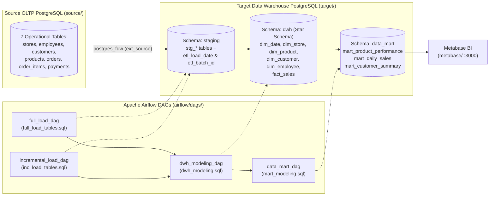

# Multi-Layer Enterprise Data Warehouse & BI Pipeline (`Staging → DWH → Data Mart`)


An end-to-end **Enterprise Data Warehouse (DWH) & ELT Pipeline** for retail operations (`TechMart`), implementing a 3-schema analytical architecture (`staging` → `dwh` → `data_mart`) across isolated **PostgreSQL** instances connected via **Foreign Data Wrappers (`postgres_fdw`)**, orchestrated by **Apache Airflow** (`SQLExecuteQueryOperator`), and visualized in **Metabase**.

---

## System Architecture



---

## Multi-Layer Warehouse Design

### 1. Staging Layer (`staging.*`) — Full & Incremental Upsert Loads
- **Cross-Database Ingestion (`ext_source`):** Uses PostgreSQL Foreign Data Wrapper to query the operational OLTP database directly from the target DWH instance without intermediate flat-file dumps.
- **`full_load_dag` (`full_load_tables.sql`):** Truncates and reloads `stg_stores`, `stg_employees`, `stg_customers`, `stg_products`, `stg_orders`, and `stg_order_items`, stamping each record with `etl_load_date = NOW()` and Airflow's templated `'{{ run_id }}'` (`etl_batch_id`).
- **`incremental_load_dag` (`inc_load_tables.sql`):** Performs idempotent `INSERT ... ON CONFLICT (<pk>) DO UPDATE` upserts (SCD Type 1 Synchronization) to capture new and modified operational records.

### 2. Core Data Warehouse Layer (`dwh.*`) — Kimball Star Schema
Orchestrated by `dwh_modeling_dag` (`sql/dwh_modeling.sql`):
- **Dimensions (`dim_store`, `dim_product`, `dim_customer`, `dim_employee`, `dim_date`):**
  - Surrogate keys (`store_key`, `product_key`, `customer_key`, `employee_key`) with validity tracking (`effective_from`, `effective_to`, `is_current`).
  - Dynamic demographic bucketing (`age_group`: `18-25`, `26-35`, `36+`) derived during `dim_customer` transformation.
  - Pre-populated calendar dimension (`dim_date`) generated via `generate_series('2022-01-01', '2026-12-31', '1 day')`.
- **Fact Table (`fact_sales`):**
  - Granularity: Individual order line item (`item_id`), joined across all 5 dimensions (`date_key`, `customer_key`, `product_key`, `store_key`, `employee_key`).
  - Pre-calculates financial metrics: `gross_amount = quantity * unit_price`, `net_amount = gross_amount - discount`, and `profit_amount = net_amount - (quantity * cost)`.
  - Enforces idempotency via `WHERE NOT EXISTS (SELECT 1 FROM dwh.fact_sales fs WHERE fs.item_id = oi.item_id)`.

### 3. Analytical Data Mart Layer (`data_mart.*`)
Orchestrated by `data_mart_dag` (`sql/mart_modeling.sql`):
- **`mart_product_performance`:** Aggregates non-cancelled orders by product, computing `total_quantity_sold`, `total_revenue`, `total_profit`, `profit_margin_pct`, `total_orders`, and `avg_discount`.
- **`mart_daily_sales`:** Store-level daily KPI mart tracking `total_orders`, `gross_revenue`, `net_revenue`, `total_discount`, `total_profit`, and `avg_order_value`.
- **`mart_customer_summary`:** Customer lifetime value (LTV) schema tracking `first_order_date`, `last_order_date`, `total_orders`, `total_spent`, and `avg_order_value`.

---

## Repository Structure

```text
├── airflow/
│   ├── dags/
│   │   ├── full_load.py               # Airflow DAG: Full staging reload
│   │   ├── inc_load.py                # Airflow DAG: Incremental upsert (ON CONFLICT DO UPDATE)
│   │   ├── dwh_layer.py               # Airflow DAG: Staging -> Kimball Star Schema (dwh.*)
│   │   ├── data_mart.py               # Airflow DAG: DWH -> Aggregated Data Marts (data_mart.*)
│   │   └── sql/
│   │       ├── full_load_tables.sql   # Full load SQL templates with {{ run_id }} lineage
│   │       ├── inc_load_tables.sql    # Incremental upsert SQL templates
│   │       ├── dwh_modeling.sql       # Dimension upserts & idempotent fact_sales loading
│   │       └── mart_modeling.sql      # Analytical aggregations for BI reporting
│   ├── docker-compose.yaml            # Apache Airflow multi-container stack
│   └── .env.example                   # Environment template for Airflow
├── source/
│   ├── docker-compose.yml             # Operational OLTP PostgreSQL container
│   └── init_source.sql                # 7-table OLTP schema & retail seed data
├── target/
│   ├── docker-compose.yml             # Target DWH PostgreSQL container
│   └── init_target.sql                # DDL for staging, dwh, and data_mart schemas + dim_date generator
└── metabase/
    └── docker-compose.yml             # Metabase BI analytics container (:3000)
```

---

## Quick Start

```bash
# 1. Start Source OLTP and Target DWH PostgreSQL instances
docker compose -f source/docker-compose.yml up -d
docker compose -f target/docker-compose.yml up -d

# 2. Configure and launch Apache Airflow
cp airflow/.env.example airflow/.env
docker compose -f airflow/docker-compose.yaml up -d

# 3. Launch Metabase BI
docker compose -f metabase/docker-compose.yml up -d
```
